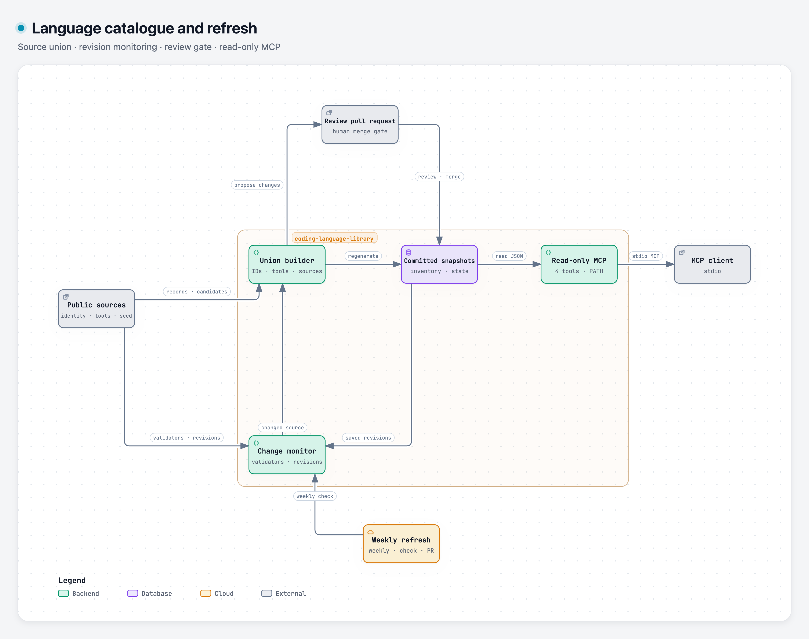

# Architecture

[Interactive diagram](architecture/coding-language-library.architecture.html) · [Editable diagram source](architecture/coding-language-library.architecture.json)

`harvest_wikipedia.py` records the MediaWiki list as a discovery seed only.
`build_inventory.py` joins PLDB and Wikidata identity records with GitHub Linguist,
Mason, and Homebrew metadata; Wikipedia entries do not determine inventory membership.
`verify_inventory.py` checks the generated snapshot and the curated suitability
profiles, including claim statuses, conditions, and HTTPS evidence. The stdio
MCP server reads the committed files. It does not install tools or launch
language servers. The server runs from a checkout or from the installed
package, whose wheel bundles the `data/` snapshots alongside `mcp/`;
the server resolves the first layout that has an inventory.
`recommend_stack` filters and ranks recorded stacks against
a structured task profile; conditional support stays unknown, and unevidenced
constraints are reported rather than guessed. Constraint terms left in the
task text are flagged in `unstructured_terms`, not parsed.

A catalogue match is not a compatibility check. Python with Pyright is the only
adapter pairing marked tested.
